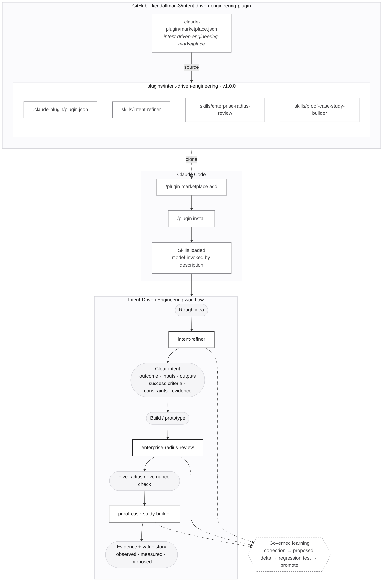
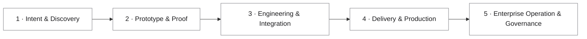

# Intent-Driven Engineering — Claude Code Plugin Marketplace

Claude Code plugin marketplace for **Intent-Driven Engineering (IDE)**.

## Install

```text
/plugin marketplace add kendallmark3/intent-driven-engineering-plugin
/plugin install intent-driven-engineering@intent-driven-engineering-marketplace
```

## Plugins

| Plugin | Version | Skills |
|---|---|---|
| [`intent-driven-engineering`](plugins/intent-driven-engineering) | 1.0.0 | `intent-refiner`, `enterprise-radius-review`, `proof-case-study-builder` |

```text
ROUGH IDEA → intent-refiner → CLEAR INTENT → BUILD
  → enterprise-radius-review → GOVERNANCE CHECK
  → proof-case-study-builder → EVIDENCE + VALUE STORY
```

## Architecture



### Five-radius model (`enterprise-radius-review`)



## Local development

```bash
claude --plugin-dir ./plugins/intent-driven-engineering
```

See [plugins/intent-driven-engineering/README.md](plugins/intent-driven-engineering/README.md) for details.

---
Part of [LearnTeachMaster.org](https://learnteachmaster.org) · [intent-driven-engineering.com](https://intent-driven-engineering.com)
